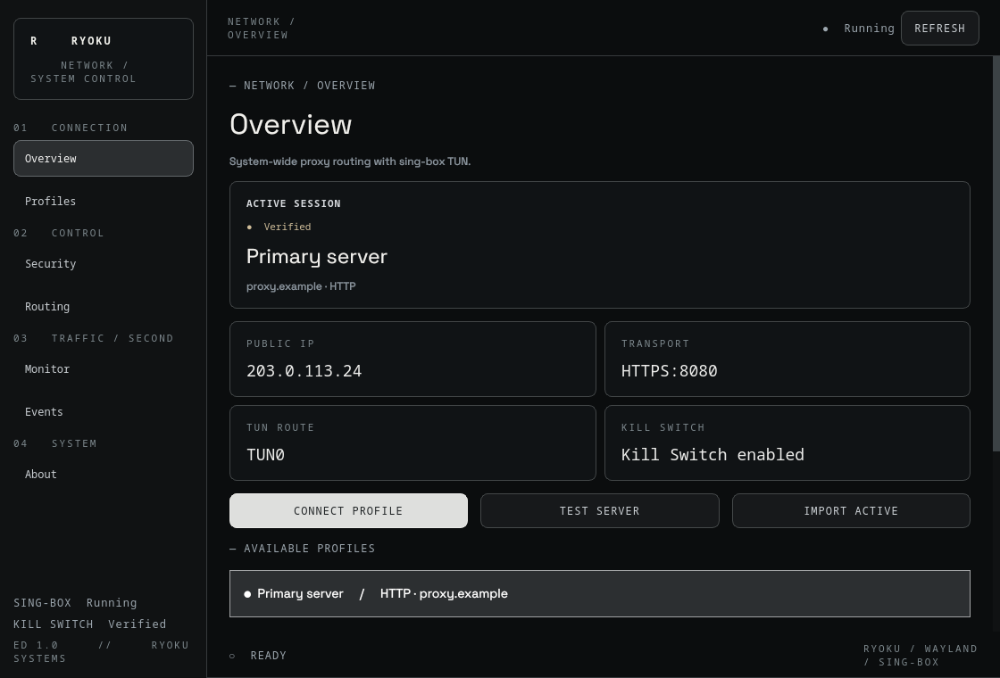
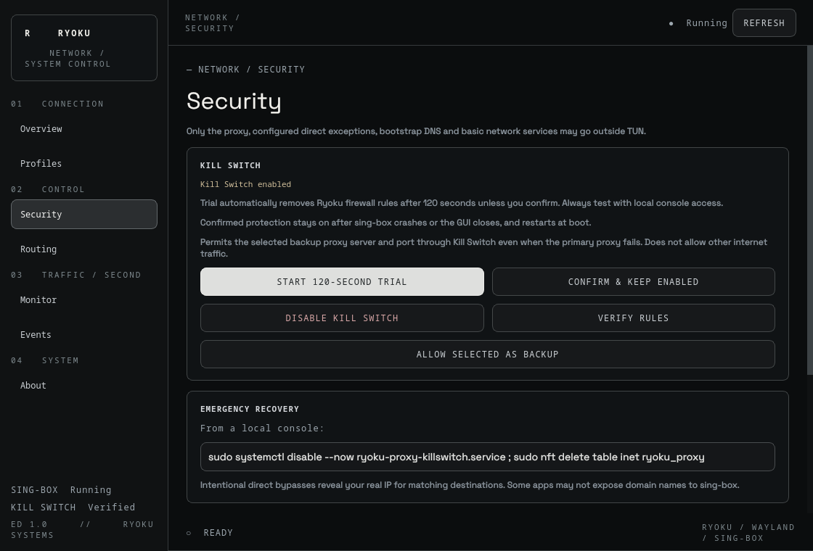

# Ryoku Proxy · ED 1.0

A native Qt6/Wayland dashboard for an existing sing-box TUN configuration on Ryoku Linux.

[Russian](README.ru.md) · [Release v1.0](https://github.com/x-devnull/ryoku-proxy/releases/tag/v1.0) · [Website](https://x-devnull.github.io/ryoku-proxy/) · [Security](SECURITY.md)





## Features

- HTTP, HTTPS and SOCKS5 profiles, URL import, connection checks and manual switching with rollback.
- Destination routing: IP/CIDR, exact domains, wildcard subdomains and local-network detection.
- Isolated nftables Kill Switch with a 120-second recoverable activation trial and persistent mode after confirmation.
- TUN throughput, authenticated localhost connection monitoring, public IPv4 checks and service logs.
- English/Russian interface, Ryoku styling and tray controls; reduced polling while hidden.

Git tag: **v1.0**. Package version: **1.0.0**. Edition: **ED 1.0**.
Earlier 4.x development names do not change the existing saved-data formats.

## Requirements

Ryoku / Arch Linux, Python with PySide6, sing-box, nftables, iproute2, polkit,
curl, systemd and a working graphical polkit agent. Secret Service / libsecret
is recommended for passwords.

**This is a manager for an existing sing-box setup.** It expects
`/etc/sing-box/config.json` with a supported HTTP/SOCKS outbound tagged `proxy`,
an explicit TUN interface and DNS/routing rules. Monitoring currently reads
host counters from `tun0`. The helper validates supported configuration before
applying changes; the installer does not create or replace your configuration.

## Install on Ryoku / Arch Linux

Download **ryoku-proxy-1.0.0-1-any.pkg.tar.zst** from the
[release](https://github.com/x-devnull/ryoku-proxy/releases/tag/v1.0), then:

```sh
sudo pacman -U ./ryoku-proxy-1.0.0-1-any.pkg.tar.zst
ryoku-proxy
```

Pacman installs the application, desktop entry, system helper, policy and
required repository dependencies. Launch **Ryoku Proxy** from the application
menu. System operations use normal polkit password prompts by default.
Optional local-session passwordless access: `sudo ryoku-proxy-access grant USER`;
revoke it with `sudo ryoku-proxy-access revoke USER`.

The installer does not create your sing-box configuration or activate the
firewall. See the requirements above. The package is not yet listed in AUR or
an official pacman repository, so `yay -S ryoku-proxy` is not available.
Flatpak is not supplied: the privileged host helper and system firewall policy
are shipped through the native Arch package.

For a local package build, place the release source archive and matching
PKGBUILD in an empty directory and run `makepkg -si`. Uninstall with
`sudo pacman -R ryoku-proxy` after disabling Kill Switch. Removal is blocked
while the managed firewall is active. If you previously used the user GUI
installer, remove its overriding `~/.local/bin/ryoku-proxy`, directory
`~/.local/share/ryoku-proxy`, user desktop entry and user icon to use the
system package. Legacy shell installers remain for development only.

## First connection

1. Import the active sing-box configuration or add a proxy in **Profiles**.
2. Test the server, then connect. **Monitor** can enable the optional local API.
3. Review direct exceptions in **Routing** before applying them.
4. With local console access, start the **120-second trial** in **Security**.
   Verify internet/LAN and confirm only if everything works. An unconfirmed
   trial removes the Ryoku firewall automatically.
5. You may authorize a selected backup endpoint while the Kill Switch is active,
   then switch to it manually. Background automatic failover is not implemented.

To force a UI language, set `RYOKU_PROXY_LANG=en` or `RYOKU_PROXY_LANG=ru`.
Otherwise the locale selects English or Russian.

## Safety and recovery

Direct exceptions deliberately bypass the proxy and can reveal your real IP.
Domain matching depends on recognizable hostnames; a privileged process can
set socket marks. HTTP proxies do not provide general UDP tunneling. Bootstrap
DNS may use an explicitly permitted direct resolver. This is not a security
boundary against root and does not claim independently audited leak protection.

To recover locally, these commands remove protection and allow direct traffic:

```sh
sudo systemctl disable --now ryoku-proxy-killswitch.service
sudo systemctl stop ryoku-proxy-trial.timer
sudo nft delete table inet ryoku_proxy
sudo rm -f /run/ryoku-proxy-killswitch-trial /etc/ryoku-proxy/killswitch.json
```

Profiles and API tokens are user-only files (0600) under `~/.config/ryoku-proxy`.
Passwords use Secret Service where available, otherwise the private profile file.
Never include those files or real credentials in bug reports.

## Development and publication

```sh
python -m unittest discover -s tests -v
bash -n install.sh install-user.sh uninstall.sh
python tools/validate_release.py
python tools/source_archive.py
```

`dist/` contains a deterministic source archive, SHA-256 file and matching
local Arch PKGBUILD. No AUR submission has been made.

GitHub Actions validates pushes/PRs, deploys `site/` to GitHub Pages on `main`,
and publishes source assets for tag `v1.0`. See [release notes](docs/RELEASE_NOTES.md)
and [release checklist](docs/RELEASE.md). Live Wayland, packet-level firewall,
recovery and clean-system package scenarios still need validation; offscreen
GUI tests do not establish those guarantees.

MIT · [x_devnull](https://github.com/x-devnull)
