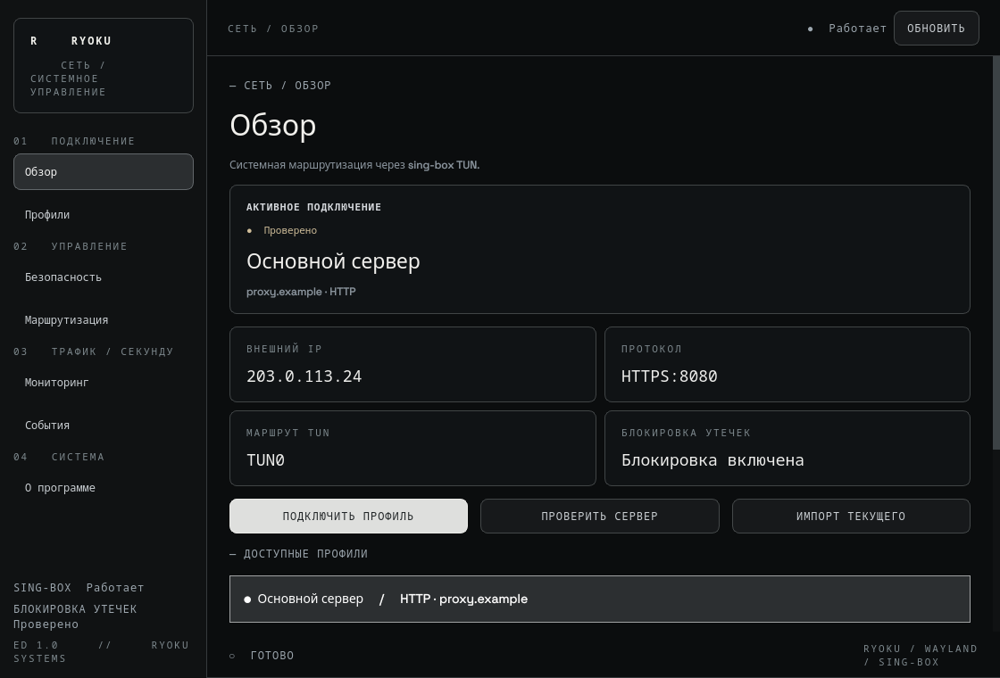
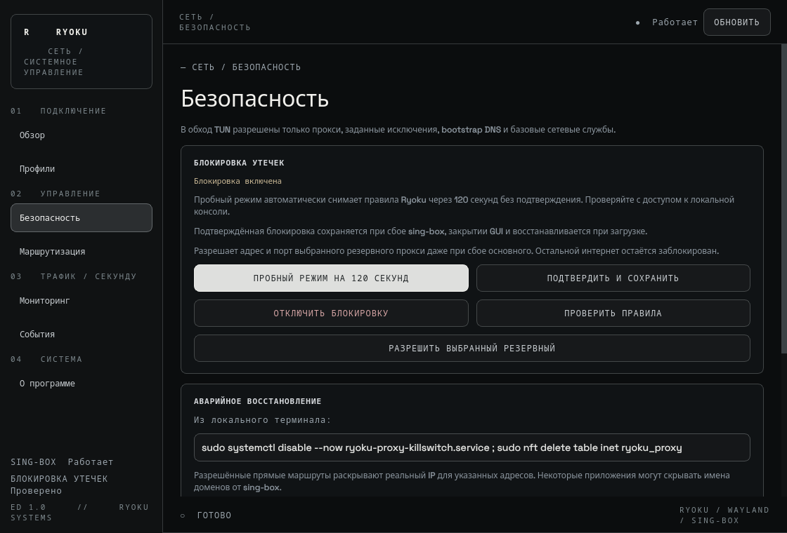

# Ryoku Proxy · ED 1.0

Нативная панель Qt6/Wayland для существующей конфигурации sing-box TUN в Ryoku Linux.

[English](README.md) · [Релиз v1.0](https://github.com/x-devnull/ryoku-proxy/releases/tag/v1.0) · [Сайт](https://x-devnull.github.io/ryoku-proxy/) · [Безопасность](SECURITY.md)





## Возможности

- Профили HTTP, HTTPS и SOCKS5: импорт URL, проверка соединения и ручное переключение с откатом при ошибке.
- Маршрутизация: IP/CIDR, точные домены, маски поддоменов и поиск локальных сетей.
- Kill Switch в отдельной таблице nftables: пробное включение на 120 секунд и постоянный режим после подтверждения.
- Скорости TUN, подключения через локальный API с токеном, публичный IPv4 и журнал службы.
- Русский и английский интерфейс, стиль Ryoku и управление из трея; меньше опросов при скрытом окне.

Тег релиза: **v1.0**. Версия пакета: **1.0.0**. Редакция: **ED 1.0**.
Прежние обозначения 4.x относились к разработке; форматы сохранённых данных не менялись.

## Требования

Ryoku / Arch Linux, Python с PySide6, sing-box, nftables, iproute2, polkit,
curl, systemd и работающий графический агент polkit. Для хранения паролей
рекомендуется Secret Service / libsecret.

**Приложение управляет уже настроенным sing-box.** Нужен
`/etc/sing-box/config.json` с поддерживаемым outbound HTTP/SOCKS с тегом `proxy`,
явно заданным TUN-интерфейсом и правилами DNS/маршрутизации. Мониторинг
системных счётчиков сейчас читает `tun0`. Помощник проверяет конфигурацию
перед изменениями; установщик не создаёт и не заменяет её.

## Установка в Ryoku / Arch Linux

### Подписанный репозиторий pacman (автообновления)

После настройки подписи сопровождающим и первой публикации скачай
`https://x-devnull.github.io/ryoku-proxy/repo/ryoku-proxy.asc` и проверь ключ:
`gpg --show-keys --with-fingerprint ryoku-proxy.asc`. Сверь **полный отпечаток
через независимый доверенный канал** и только после этого импортируй:

```sh
sudo pacman-key --add ryoku-proxy.asc
sudo pacman-key --lsign-key 54603E732557B97D68F0C69D0C963BD1263CF3FE
```

Добавь в `/etc/pacman.conf`:

```ini
[ryoku-proxy]
SigLevel = Required
Server = https://x-devnull.github.io/ryoku-proxy/repo/arch/any
```

Установка: `sudo pacman -Syu ryoku-proxy`. В дальнейшем приложение обновляется
вместе с `sudo pacman -Syu`. Регистрация AUR не нужна. Не отключай проверку
подписей. До первой публикации подписанного репозитория используй ручной
пакет ниже. Настройка сопровождающим: [публикация пакетов](docs/PACKAGES.md).

### Ручной пакет Arch (без подключения репозитория)


Скачай **ryoku-proxy-1.0.0-2-any.pkg.tar.zst** из
[релиза](https://github.com/x-devnull/ryoku-proxy/releases/tag/v1.0), затем:

```sh
sudo pacman -U ./ryoku-proxy-1.0.0-2-any.pkg.tar.zst
ryoku-proxy
```

Pacman устанавливает приложение, пункт меню, системный помощник, polkit и
зависимости из подключённых репозиториев. Запускай **Ryoku Proxy** из меню
приложений. Системные действия по умолчанию требуют пароль через polkit.
Необязательный доступ без повторного пароля: `sudo ryoku-proxy-access grant USER`;
отзыв: `sudo ryoku-proxy-access revoke USER`.

Установка не создаёт конфигурацию sing-box и не включает firewall. Требования
описаны выше. Проект не опубликован в AUR или официальном репозитории
дистрибутива, поэтому `yay -S ryoku-proxy` недоступен. Flatpak не поставляется:
привилегированный помощник и системная политика устанавливаются Arch-пакетом.

Для локальной сборки помести архив исходников и соответствующий PKGBUILD
в пустой каталог и запусти `makepkg -si`. Удаление: `sudo pacman -R ryoku-proxy`
после отключения Kill Switch. Активная защита блокирует удаление пакета.
Если ранее установлен пользовательский GUI, убери его перекрывающие файлы:
`~/.local/bin/ryoku-proxy`, каталог `~/.local/share/ryoku-proxy`, запись меню
и пользовательскую иконку. Shell-установщики оставлены для разработки.

## Debian-пакет (ручное скачивание)

Скачай `ryoku-proxy_1.0.0-2_all.deb` и SHA256SUMS из релиза:

```sh
sha256sum --ignore-missing -c SHA256SUMS
sudo apt install ./ryoku-proxy_1.0.0-2_all.deb
```

Цель — Debian 13 с указанными зависимостями PySide6 и sing-box >=1.14.
Если подходящего sing-box нет в подключённых репозиториях, используй
[официальную инструкцию](https://sing-box.sagernet.org/installation/package-manager/).
По-прежнему нужны настроенный sing-box TUN и графический агент polkit.
Это дополнительный формат пакета: живая совместимость Debian ещё не
подтверждена, собственный APT-репозиторий не предоставляется.
Подробности: [пакеты](docs/PACKAGES.md).

## Первое подключение

1. В **Профилях** импортируй текущую конфигурацию sing-box или добавь прокси.
2. Проверь сервер и подключись. В **Мониторинге** можно включить локальный API.
3. В **Маршрутизации** проверь прямые исключения перед применением.
4. Имея доступ к локальной консоли, включи **пробный режим на 120 секунд**
   в **Безопасности**. Проверь интернет/LAN и подтверди постоянную защиту.
   Без подтверждения правила Ryoku автоматически снимаются.
5. При включённой защите можно разрешить адрес резервного прокси и переключиться
   вручную. Автоматического фонового переключения нет.

Язык можно задать через `RYOKU_PROXY_LANG=ru` или `RYOKU_PROXY_LANG=en`;
иначе он выбирается по локали.

## Безопасность и восстановление

Прямые исключения обходят прокси и могут раскрывать реальный IP. Доменные
правила зависят от распознавания имени; привилегированные процессы могут
выставлять socket marks. HTTP-прокси не обеспечивает общий UDP-туннель.
Bootstrap DNS может идти через явно разрешённый прямой резолвер. Независимый
аудит защиты от утечек не проведён; приложение не защищает от root.

Восстановление из локальной консоли — команды снимают защиту и разрешают
прямой трафик:

```sh
sudo systemctl disable --now ryoku-proxy-killswitch.service
sudo systemctl stop ryoku-proxy-trial.timer
sudo nft delete table inet ryoku_proxy
sudo rm -f /run/ryoku-proxy-killswitch-trial /etc/ryoku-proxy/killswitch.json
```

Профили и токены хранятся с правами 0600 в `~/.config/ryoku-proxy`.
Пароли используют Secret Service, а при его недоступности — приватный файл
профилей. Не прикладывай эти файлы и настоящие пароли к сообщениям об ошибках.

## Разработка и публикация

```sh
python -m unittest discover -s tests -v
bash -n install.sh install-user.sh uninstall.sh
python tools/validate_release.py
python tools/source_archive.py
```

В `dist/` появятся воспроизводимый архив, SHA-256 и PKGBUILD для локальной
сборки Arch. В AUR проект не отправлялся.

GitHub Actions проверяет изменения, публикует `site/` на GitHub Pages из `main`
и создаёт релиз с исходниками по тегу `v1.0`. См. [заметки релиза](docs/RELEASE_NOTES.md)
и [чек-лист](docs/RELEASE.md). Живой Wayland, поведение firewall на уровне
пакетов, восстановление и установка пакета на чистую систему ещё требуют
проверки; offscreen-тесты этих гарантий не дают.

MIT · [x_devnull](https://github.com/x-devnull)
